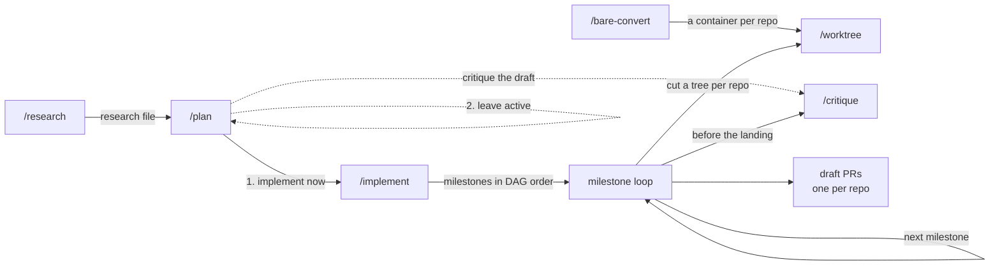

# agents

Claude Code and Codex configuration: always-on rules, plus a research, plan, and implement workflow
built on each host's native subagents. Claude desktop is the primary host. Forked from Deven
Jahnke's [jahnkelabs/agents](https://github.com/jahnkelabs/agents).

## Install

```bash
./scripts/install.sh
```

One run installs both runtimes.

| Destination | Contents | Runtime |
|---|---|---|
| `~/.claude/rules/<name>.md` | always-on working agreements — **linked per file** | Claude |
| `~/.claude/skills/<name>/` | slash commands — **linked per skill** | Claude |
| `~/.claude/agents/<name>.md` | the worker definitions the skills spawn — **linked per file** | Claude |
| `~/.claude/references` | adapters — whole directory, **never pruned** | Claude |
| `~/.claude/bin/wt-clone.sh` | the `/worktree` clone helper — **linked directly, never pruned** | both |
| `~/.claude/bin/deny-git-writes.sh` | the `implement-worker` git hook — **linked directly, never pruned** | Claude |
| `~/.agents/skills/<name>/` | the same skills — **linked per skill** | Codex |
| `~/.agents/references` | the same adapters — whole directory, **never pruned** | Codex |
| `~/.codex/AGENTS.md` | every rule concatenated — **generated** | Codex |

The script links one entry at a time, so each destination directory stays a real one you own.
It leaves anything else you keep there alone. Nothing you create locally reaches this repository.

**Switching from another checkout.** Run this script from the checkout you want. It repoints
every link that has a counterpart here, and it prunes every per-entry link into the other
checkout that has none. The other checkout's git hooks still regenerate `~/.codex/AGENTS.md` when
you commit or check out there. Remove those hooks, or that checkout.

**`~/.codex/AGENTS.md` is the one file this repository generates whole rather than links.** Codex reads
its instructions from a single file and resolves no includes, so a directory of rules cannot
reach it any other way. A file you wrote yourself is backed up before the first generation. Git
hooks regenerate it after a commit, a checkout, and a merge, so a rule edit you commit reaches
Codex without a re-run. `./scripts/install.sh --rules-only` does that regeneration alone.

**Codex has no `disable-model-invocation`.** On Claude, the model cannot invoke `/bare-convert`.
On Codex it can invoke it itself. It still gates on your approval before anything moves, so the
guarantee weakens from "you start it" to "you approve it".

`references/` is a whole-directory link because it is not a Claude Code directory. It exists so
a skill or a rule can read a file from a stable path. Nothing else writes there. It holds three
kinds. A runtime adapter carries the headless command for a critic on a runtime other than the
host: `runtime-codex.md` for a Claude-hosted run, and `runtime-claude.md` for a Codex-hosted one.
Each records the version it was measured against. `critique-findings.schema.json` is the shape
every critic's findings take. A skill's own overflow holds what one skill cannot fit under its
size cap, and `implement-waves.md` is the one today.

The `runtime-` prefix is load-bearing. A file named `claude.md` collides with `CLAUDE.md` on a
case-insensitive filesystem. Claude Code then loads the adapter as project instructions in every
session that opens this repository.

An adapter is content you need at one moment rather than in every session. A headless launch
command belongs here because a wrong flag fails the launch with a visible error. A rule keeps
anything whose absence fails silently.

Re-run the script after you **add or rename** a file. An edit to an existing rule, skill, or
agent takes effect immediately. The script prunes a per-entry link — a rule, a skill, or an
agent — whose source is gone. It never prunes the direct links: `references/` and the two in
`bin/`. A renamed source there leaves a dangling link. It moves anything real in the way to
`~/.claude/backups/` first. Override the repository root with `AGENTS_REPO=/path/to/agents`.

### Uninstall

```bash
./scripts/uninstall.sh
```

It removes every link that resolves into this checkout, the `~/.codex/AGENTS.md` this checkout
generated, and the git hooks the install wrote. It leaves everything else alone: your own files,
links into another checkout, `~/.claude/backups/`, and the run state in `~/.agents/work`.

### Requirements

| | |
|---|---|
| Claude Code, desktop app or CLI | `/research`, `/plan`, `/implement`, `/critique` — measured on 2.1.310 |
| `jq` | the `implement-worker` git hook, which blocks every command when `jq` is missing |
| `codex` CLI, signed in | the Codex critic in `/critique`'s default roster — measured on 0.163.0. Without it, critique falls back to one Claude critic |
| `timeout` (Homebrew `coreutils` on macOS) | a headless critic |
| `gws` CLI, signed in | `/gws` |
| Nothing | `/grill`, `/worktree`, `/bare-convert`, and the rules |

**Let the skills reach the state directory.** Plans, task specs, and critique inputs live under
`~/.agents/work`, which sits outside every project. Workers read them there, and the orchestrator
writes them. Add its absolute path to `permissions.additionalDirectories` in
`~/.claude/settings.json`, or an access outside the project can ask first. The desktop app's file
pane ignores that setting, so `/plan` and `/research` also grant the folder to their session before
they open a plan or a research file there. In auto mode that grant asks nothing once you trust the
folder:

```json
{ "permissions": { "additionalDirectories": ["/Users/<you>/.agents/work"] } }
```

## Rules

All six rules load into every session.

| Rule | Description |
|---|---|
| [agent-orchestration](rules/agent-orchestration.md) | Fan out with the host's native subagents, each at the model and effort its job needs. The host's completion notice is the join, and run state lives in files |
| [chat-vocabulary](rules/chat-vocabulary.md) | Six reserved headings and one footer mark every message the user must act on; nothing else gets a heading |
| [comment-discipline](rules/comment-discipline.md) | Comments are disallowed by default; after the implementation, propose only the few that pass the admission test |
| [pr-first-contributions](rules/pr-first-contributions.md) | PR-first git workflow with conventional titles, draft PRs, stacked bases, and squash-merge descriptions |
| [testing-philosophy](rules/testing-philosophy.md) | Contract-first tests through production entry points; refactor-resistant |
| [yagni](rules/yagni.md) | Build for the present need; defer what is cheap to add later |

Each description above copies that rule's `description:` frontmatter. Copy it rather than
paraphrase it, because a paraphrase drifts from the rule it describes.

## Skills

| Skill | Purpose | Invocation |
|---|---|---|
| [`/research`](skills/research/SKILL.md) | Investigate a codebase with parallel agents and write the findings to a research file | you or the agent |
| [`/critique`](skills/critique/SKILL.md) | Adversarial multi-model review of a diff, plan, files, or PR | you or the agent |
| [`/grill`](skills/grill/SKILL.md) | Interrogate a decision one question at a time | you or the agent |
| [`/worktree`](skills/worktree/SKILL.md) | Cut, provision, and tear down one milestone worktree | you or the agent |
| [`/plan`](skills/plan/SKILL.md) | Research, grill, and produce a plan in one plan file | you or the agent |
| [`/implement`](skills/implement/SKILL.md) | Compose a plan into milestones, and ship each one as its own PRs | you or the agent |
| [`/gws`](skills/gws/SKILL.md) | Read and change Google Drive, Docs, Sheets, and Slides files through the `gws` CLI | you or the agent |
| [`/bare-convert`](skills/bare-convert/SKILL.md) | Set up or convert a repository into the bare-plus-worktrees layout | **you only** |

`/bare-convert` keeps `disable-model-invocation: true`, so the agent cannot decide to run it. It
moves your working tree. It does not appear in the agent's skill listing, so it costs no context
until you invoke it.

The other seven stay model-invocable. Five of them carry `when_to_use` trigger phrases. Say
"grill me on this" or "find the bugs" and the skill runs without a command name. `/plan` and
`/implement` carry none, so a command name still starts each one. They are model-invocable
because `/plan` calls `/implement`.

`/worktree` and `/gws` are the two trigger-phrase skills that also write. `/implement` calls
`/worktree` per milestone, so it must be callable. Its destructive half lives in `/bare-convert`,
which keeps the gate. `/gws` confirms every write with you before it sends one.

**No skill overrides the session's model.** Every skill respects your session's choice, including
a `[1m]` variant. A skill sets `effort` only where the shape of the work justifies it:

| Skill | `effort` | Why |
|---|---|---|
| `grill` | `xhigh` | pure judgment, so the depth pays on every run |
| the rest | inherits | the session's effort is yours to choose, because every worker's is set on its spawn call |

**Session effort and worker effort are separate.** A skill that fans out sets each worker's model
and effort on that worker's own spawn call, per task. The session's effort governs the
orchestrator alone: scoping, grilling, synthesis, the census, and triage. A raise therefore costs
one session, not every worker. Run a `/plan` or `/implement` session at `xhigh`, and at `max`
where a wrong plan is expensive.

An effort override applies for the rest of the turn, and it resets on your next prompt. For
one-off depth, put `ultrathink` in the prompt instead.



## Agent definitions

The skills spawn four workers, each defined in `agents/` and installed to `~/.claude/agents/`.

| Definition | Class | Tools | Spawned by |
|---|---|---|---|
| [`research-worker`](agents/research-worker.md) | read-only | `Read`, `Grep`, `Glob` | `/research`, `/plan` |
| [`critique-worker`](agents/critique-worker.md) | read-only | `Read`, `Grep`, `Glob` | `/critique` |
| [`refute-worker`](agents/refute-worker.md) | read-only | `Read`, `Grep`, `Glob` | `/critique`, for a one-model roster |
| [`implement-worker`](agents/implement-worker.md) | editing | `Read`, `Grep`, `Glob`, `Edit`, `Write`, `Bash`, and a git-write hook | `/implement` |

Each one runs in the background, takes its model and effort from the call, and sets `maxTurns`
as its bound. Each description names the skill that spawns it, so Claude does not delegate
unrelated work to it. The definition carries what every worker of its class shares, and the brief
carries the one job.

## How the system divides state

**Run state lives in files, in `~/.agents/work`.** Research and plans are short-lived, and a
finished plan's directory moves into `archive/`. `state.yml` holds the schedule while
`/implement` runs a plan, and it makes a stopped run resumable.

Nothing in this repository stores your work.

| Kind | Path under `~/.agents/work` |
|---|---|
| Research | `research/<YYYY-MM-DD>t<HHMM>-<topic>.md` |
| Plan | `plans/<slug>/plan.md` |
| Schedule | `plans/<slug>/state.yml` |
| Task spec | `plans/<slug>/tasks/<milestone>-<task>.md` |
| Escalated worker report | `plans/<slug>/reports/<milestone>/<task>.md` |
| Critique inputs and outputs | `plans/<slug>/critique/<segment>/` |
| Finished work | `archive/` |

## How the workflow behaves

**Every worker is a native subagent.** `/research`, `/plan`, `/implement`, and `/critique` fan
out with the host's own subagents. [agent-orchestration](rules/agent-orchestration.md) carries
the policy and the reasoning, so the policy also holds for a fan-out that no skill started. Each
skill carries only its own brief and constraints.

**Workers run on the host. Only a critic leaves it.** A critic on another runtime runs as a
headless command with a read-only sandbox and structured output. A plan records the critique
roster in its `### References`, and `/implement` reads it without asking. Only a standalone
`/critique` asks which models to use.

**The host's notice is the join.** Every worker runs in the background, and the host notifies the
orchestrator when it finishes or fails. A headless critic's exit notifies it the same way.
Nothing polls, and nothing reads idleness as completion, because a worker that reasons at length
emits nothing and looks finished.

**The orchestrating session runs in auto mode, never in a bypass mode.** A background worker
inherits `auto`, `acceptEdits`, or `bypassPermissions` from the session, whatever its definition
says. A worker that needs approval surfaces its prompt in your session and names itself.

**Gates carry evidence for what they inferred.** A confirmation justifies the judgments it could
get wrong: why these repos, why these investigation areas, why this is out of scope. A bad guess
is then visible rather than buried. A gate prints a looked-up fact without argument; a repo list
inferred from file references needs one. A gate's opening message carries a reserved heading and
fences its block, per [chat-vocabulary](rules/chat-vocabulary.md). `Approve` marks a proposal,
and `Deciding` marks a question you cannot answer yourself.

**`/plan` grills you.** Gate A shows one changeable line, `Critique:`, so no later question asks
for a roster. One question per message, never two. Each one carries a fenced context block, a
mandatory recommendation, and the `⏸` footer. Only the first question carries the `Deciding`
heading, so a long grilling does not become a column of headings. The question whose answer
changes the most other answers comes first. `/plan` looks up anything the filesystem or a tool
can tell it, rather than asking you. Its scope gate names the decisions it expects to put to you.
That gate also reports how far each tree sits behind its default branch. It stops when the
questions left are details you would rather see than specify.

**`/plan` censuses the inbound references before it writes the plan.** It searches for three
kinds of reference to every file a slice changes. Those kinds are the caller, the test, and the
standard whose text the change makes false. The third kind is the one that gets missed, because
no import points to it. Nineteen of thirty sessions shipped an incomplete file list before this
step existed.

**Three words carry the delivery model, and each means one thing.** A **slice** is one worker's
unit of work: narrow, vertical, one repository. A **milestone** is a consumable chunk of a plan
and the unit of delivery, and it may span repositories. A **wave** is the concurrency schedule
inside a milestone, taken from file overlap.

**The plan declares slices; `/implement` composes the milestones.** A plan declares slices with
their file scopes. It also declares the two constraints only it knows: which slices must share a
worker, and which must follow another. Composing slices into milestones, ordering those
milestones, and choosing a model and effort are scheduling. `/implement` decides the schedule at
execution time, against facts that are current then.

**A milestone lands one PR per repository it touches.** Its outcome is one sentence with no
`and`, and each of its PR titles states that outcome scoped to its repository. Two milestones
that touch one file ship in sequence, because their branches would otherwise conflict.

**You choose where each repository's work happens.** `/implement --in <mode>` takes one of three
modes. `container` gives each milestone a worktree of its own inside a converted repository,
through `/worktree`. `checkout` works in your own folder on a feature branch, the way a person
would. `main` does the same and commits straight to the default branch, with no PR. Without
`--in`, the layout decides: a converted repository takes `container`, and a plain clone takes
`checkout`. The roster gate names each repository's mode and the fact that chose it, and you can
change it there.

**You approve the roster before anything spawns.** `/implement` presents the milestones and
their PR titles first, then the waves and tiers inside each one. `/implement` writes each summary
so the tier follows from it. A task described as "three localized edits against precise line
references" argues for its own tier. The roster gate also restates the `Critique per milestone:`
line from the plan, and you can change it. Adjust any milestone boundary, model, effort, or
grouping, or approve the roster as proposed.

**A read-only worker cannot write, and an editing worker cannot run a git write.** A research
worker, a critic, and a refuter hold `Read`, `Grep`, and `Glob` alone, so none can change the
target it reads. An implement worker edits, and a `PreToolUse` hook blocks every git subcommand
outside a read-only list. Several workers share one milestone tree, so a worker that cannot
stage is safer than one asked not to. The hook reads the command line, which makes it a backstop
rather than a sandbox. Workers share your session's sandbox, so the orchestrator checks at every
join that each changed path belongs to a declared one. It commits each task's declared paths, so
history stays granular.

On Codex, a subagent takes the parent's sandbox, and no per-worker git denial exists. The roster
gate discloses that exposure there, and it does not close it.

**Workers escalate on deviation, not on failure.** A worker that cannot self-resolve records
what it found and stops. So does a worker that would have to depart meaningfully from the
approved plan. Neither one improvises. The worker's report opens with a line that says it
escalated, and the orchestrator writes that report to a file so it outlives the session. Other workers in the wave finish, and
everything appears together at the join. Once you decide, the orchestrator resumes the escalated
worker with your decision, and it keeps everything it already read.

**Critique is adversarial and multi-model.** `/critique` runs one critic per roster entry. A
Claude model runs as a `critique-worker` subagent, and Codex runs headless. The default roster is
one of each, because two runtimes miss more different defects than two models of one runtime.
A standalone run asks you for the roster and recommends that default, and `/implement` supplies
the plan's. Each critic tries to break the target
rather than survey it. Cross-model agreement is evidence that a defect is real, because two
models rarely invent one defect. One model gives no such evidence, so a refutation pass takes its
place and drops what it refutes. Agreement raises confidence, and it drops nothing. Every merged
finding reaches the filter, whether one critic found it or every critic did.

**A filter decides which findings reach you.** `/critique` accepts a finding by default. What
acceptance does then depends on who called. A milestone critique inside `/implement` applies the
fix; a standalone or `--integration` pass reports the remedy and edits nothing. Six criteria
escalate a finding to you instead:

```
C1  the fix rests on a fact the orchestrator cannot verify
C2  the fix needs you to act outside the repository
C3  the fix is irreversible, or visible outside the repository
C4  the fix changes a default posture
C5  the fix changes who decides, or who merges
C6  two fixes exist, and neither one ranks above the other on stated grounds
```

Three grounds never escalate: a nit, cross-model agreement, and a mechanical fix to a verifiable
mismatch. Serial triage cost about 115 of your turns across 8 runs. Delegated triage cost about
20 across 14.

**The ledger discloses every decision.** One line per finding, ranked by criticality. Each line
carries the claim, the action, and the alternative the orchestrator declined. The ledger is where
you correct a remedy choice, because C6 covers a genuine tie alone. `/implement` reports it with
each milestone landing, so nobody triages a finding twice.

**`/implement` critiques each milestone, not the whole run.** That critique and any escalation
block the next milestone, because a finding may change what it should do. Your review of the PR
blocks nothing. The run opens the PR, reports the landing, and starts the next milestone.

**A separate integration pass sees only what one milestone cannot.** Its lenses are
cross-milestone contract drift, plan completeness, claim consistency, and stack coherence. It may
not raise a finding that lives wholly inside one milestone's diff. That milestone already put the
finding through the filter.
